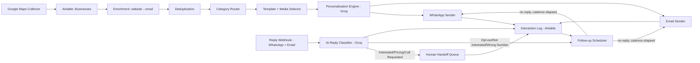

# Automated Local-Business Outreach System — Build Spec

> **Purpose of this document:** A complete, IDE-executable implementation spec. Give this file to Claude Code / Cursor and ask it to scaffold the repo phase by phase. Every phase has: what to build, exact tech choice (free-tier), file/folder to create, and the data contract it must satisfy.

---

## 0. Architecture at a glance



**One rule that governs the whole system:** nothing about *which cities, which categories, which template, which media file, or how many days between follow-ups* is hardcoded. All of it lives in Airtable config tables or YAML files, read at runtime.

---

## 1. Tech stack (all free-tier or open-source)

| Layer | Choice | Why / free-tier limits |
|---|---|---|
| Language/runtime | Python 3.11, FastAPI | Async, easy webhooks, one deployable service |
| Business discovery | Google Places API (New) — Text Search + Place Details | Google Cloud gives **$200/month recurring free credit**; a Text Search + Details pair per business costs fractions of a cent, so a few thousand businesses/month stays free. Config flag to swap in an open-source Playwright scraper as a zero-cost fallback (see §3.2 caveat). |
| Database of record | Airtable (Free plan) | Up to 1,000 records/base and unlimited bases — split by city if you outgrow one base. `pyairtable` SDK. |
| Dedup | `rapidfuzz` (pure Python, free) | Fuzzy name/address/phone matching, no API cost |
| Website scraping / email enrichment | `httpx` + `BeautifulSoup4` | Free, self-hosted |
| WhatsApp sending | **Meta WhatsApp Cloud API** (direct from Meta, not a paid BSP) | 1,000 free service conversations/month per Business Account; template messages beyond that are billed per-conversation but are still the cheapest official route. Free forever for the first 1,000/month. |
| Email sending | Gmail API (OAuth) or SMTP with an App Password | Free, ~500 sends/day/account limit — round-robin across aliases if you need more |
| AI (personalization + reply classification) | **Groq API** (Llama 3.3 70B / Llama 3.1 8B) | Generous free-tier rate limits, extremely fast inference, no cost for this volume |
| Scheduling / follow-ups | `APScheduler` (in-process cron) | Free, no extra infra; swap for Celery+Redis only if you outgrow one process |
| Reply capture | FastAPI webhook endpoints (WhatsApp Cloud API webhook, Gmail Push via Pub/Sub or IMAP polling) | Free |
| Human handoff notification | Slack Incoming Webhook (free tier) or email digest | Free |
| Hosting | Railway.app / Render free tier, or a $0 Oracle Cloud Always-Free VM | Free tier sufficient for this workload |

---

## 2. Repository layout

```
outreach-system/
├── config/
│   ├── categories.yaml          # search queries per category, per city
│   ├── templates.yaml           # category → WhatsApp template name + email template id
│   ├── media_library.yaml       # category → asset path/URL (image/video/reel)
│   ├── follow_up_policy.yaml    # cadence, max follow-ups, quiet hours
│   └── locations.yaml           # active cities + lat/lng bounding info
├── content_library/
│   ├── images/<category>/...
│   ├── videos/<category>/...
│   └── reels/<category>/...
├── src/
│   ├── collectors/
│   │   ├── places_api.py        # Google Places (New) Text Search + Details
│   │   └── scraper_fallback.py  # optional Playwright scraper
│   ├── storage/
│   │   ├── airtable_client.py
│   │   └── schema.py            # field name constants, single source of truth
│   ├── enrichment/
│   │   └── website_email_extractor.py
│   ├── dedup/
│   │   └── fuzzy_dedup.py
│   ├── routing/
│   │   ├── category_router.py
│   │   └── template_selector.py
│   ├── personalization/
│   │   └── groq_personalizer.py
│   ├── senders/
│   │   ├── whatsapp_sender.py
│   │   └── email_sender.py
│   ├── followup/
│   │   └── scheduler.py
│   ├── replies/
│   │   ├── whatsapp_webhook.py
│   │   ├── email_poller.py
│   │   └── ai_classifier.py     # Groq classification into 9 intents
│   ├── handoff/
│   │   └── human_queue.py
│   └── app.py                   # FastAPI entrypoint, wires everything
├── tests/
├── .env.example
├── requirements.txt
└── README.md
```

Build in this exact order — each phase is independently testable before moving on.

---

## 3. Phase-by-phase build

### Phase 0 — Secrets & config bootstrapping
- `.env`: `AIRTABLE_API_KEY`, `AIRTABLE_BASE_ID`, `GOOGLE_MAPS_API_KEY`, `WHATSAPP_TOKEN`, `WHATSAPP_PHONE_NUMBER_ID`, `WHATSAPP_VERIFY_TOKEN`, `GROQ_API_KEY`, `GMAIL_CLIENT_ID/SECRET` (or `SMTP_USER/SMTP_PASS`), `SLACK_WEBHOOK_URL`.
- `config/locations.yaml`:
```yaml
active_cities:
  - name: "Durg, Chhattisgarh"
    lat: 21.1904
    lng: 81.2849
    radius_km: 15
  - name: "Raipur, Chhattisgarh"
    lat: 21.2514
    lng: 81.6296
    radius_km: 20
```
- `config/categories.yaml`:
```yaml
categories:
  dance:
    search_terms: ["dance academy", "dance studio", "dance classes"]
  yoga:
    search_terms: ["yoga studio", "yoga classes"]
  gym_fitness:
    search_terms: ["gym", "fitness center", "crossfit box"]
  photography:
    search_terms: ["photography studio", "photographer"]
  music_recording:
    search_terms: ["music school", "recording studio", "music academy"]
  schools_colleges:
    search_terms: ["school", "college", "coaching institute"]
  sports:
    search_terms: ["sports academy", "sports club", "cricket coaching"]
  event_venues:
    search_terms: ["banquet hall", "event venue", "auditorium", "marriage garden"]
  cafes_restaurants:
    search_terms: ["cafe", "restaurant"]
  coworking:
    search_terms: ["coworking space", "meeting room rental"]
  art_studios:
    search_terms: ["art studio", "pottery studio", "craft workshop"]
  salons:
    search_terms: ["salon", "spa"]
  theatres:
    search_terms: ["theatre", "drama school"]
  activity_centres:
    search_terms: ["activity center", "kids activity centre", "workshop space"]
```
Adding a category later = adding a YAML block. No code change.

### Phase 1 — Google Maps collection (`collectors/places_api.py`)
1. For each `(city, category, search_term)` combination, call **Places API (New) Text Search** (`places:searchText`) with `textQuery = f"{search_term} in {city}"`.
2. For each place returned, call **Place Details** for `displayName, formattedAddress, internationalPhoneNumber, websiteUri, googleMapsUri, types, rating`.
3. Normalize into a common dict:
```python
{
  "name": str, "category": str, "city": str,
  "address": str, "phone": str, "website": str,
  "listing_url": str, "source": "google_places_api",
  "collected_at": iso_timestamp
}
```
4. Respect API pagination (`nextPageToken`) and rate limits; write raw output to a local staging JSONL file before touching Airtable (cheap replay if something downstream fails).

**§3.2 caveat — scraper fallback:** if free credit runs out, `scraper_fallback.py` can use an open-source Playwright-based Google Maps scraper (no API key, no cost). Flag it clearly in code comments that this technically sits outside Google's Terms of Service for Maps data reuse — the Places API path is the compliant default and should stay the primary switch in `locations.yaml` (`use_scraper_fallback: false`).

### Phase 2 — Airtable schema (`storage/schema.py`, `airtable_client.py`)

**Base: `Outreach System`**, tables:

**`Businesses`**
| Field | Type |
|---|---|
| Name | Single line text |
| Category | Single select (mirrors categories.yaml keys) |
| City | Single select |
| Address | Long text |
| Phone | Phone |
| Website | URL |
| Listing URL | URL |
| Email (enriched) | Email |
| Dedup Hash | Single line text (computed) |
| Status | Single select: New / Enriched / Queued / Contacted / Follow-up 1 / Follow-up 2 / Follow-up 3 / Responded / Interested / Not Interested / Opt-out / Wrong Number / Needs Human |
| Last Contacted | Date |
| Follow-up Count | Number |
| Assigned Template | Single line text |
| Notes | Long text |

**`Interactions`** (one row per message sent/received)
| Field | Type |
|---|---|
| Business (link) | Link to Businesses |
| Channel | Single select: WhatsApp / Email |
| Direction | Single select: Outbound / Inbound |
| Message Body | Long text |
| Template Used | Single line text |
| Media Attached | Attachment |
| Timestamp | Date+time |
| AI Classification | Single select: Interested / More Information / Pricing / Call Requested / Follow Later / Not Interested / Wrong Number / Opt-out / Human Review |

**`Templates`** — mirrors `config/templates.yaml`, editable from Airtable directly if preferred over YAML (pick one source of truth; recommend YAML for version control, Airtable for non-technical editing — support both by having `template_selector.py` read YAML first, fall back to Airtable).

**`HumanHandoffQueue`** — Business link, reason, priority, assigned-to, resolved (bool).

`airtable_client.py` wraps `pyairtable` with `upsert_business()`, `log_interaction()`, `update_status()`.

### Phase 3 — Enrichment (`enrichment/website_email_extractor.py`)
- If `website` present and `email` missing: fetch homepage + `/contact` page via `httpx`, regex-extract `mailto:` links and email patterns.
- Cache per-domain result to avoid re-fetching.

### Phase 4 — Deduplication (`dedup/fuzzy_dedup.py`)
- Compute `dedup_hash = normalize(phone) or (fuzzy_name + normalize(address)[:20])`.
- Before insert: query Airtable for existing `Dedup Hash`; if `rapidfuzz.fuzz.token_sort_ratio(name_a, name_b) > 92` **and** same city, treat as duplicate — merge (keep richer record, don't create a new row).
- Log skipped duplicates to a local report for auditing.

### Phase 5 — Category router + template/media selector (`routing/`)
- `category_router.py`: maps a business's raw Google `types[]` + matched `search_term` back to your canonical category key (dance, yoga, gym_fitness, …) — this is the join key into `templates.yaml` and `media_library.yaml`.
- `template_selector.py`:
```python
def select(category: str, channel: str) -> dict:
    t = templates_config[category][channel]  # {"template_name": ..., "language": ...}
    media = media_library_config[category]     # {"type": "image", "path": "..."}
    return {**t, "media": media}
```
- `config/templates.yaml` example:
```yaml
dance:
  whatsapp:
    template_name: "dance_academy_intro_v1"   # must match a Meta-approved template name exactly
    language: "en"
  email:
    subject: "Grow {{business_name}}'s enrollments with a free 15-min demo"
    body_template_path: "templates/email/dance.html"
```

### Phase 6 — Personalization (`personalization/groq_personalizer.py`)
- Call Groq (`llama-3.1-8b-instant` for speed/cost) with a strict prompt: fill placeholders `{{business_name}}`, `{{category}}`, `{{city}}` into the **pre-approved** template body — **never let the model invent new claims or change the approved template's core structure**, since WhatsApp template bodies must match what Meta approved except for the variable slots.
- For WhatsApp: only variable substitution is allowed by Meta anyway (templates are locked text with `{{1}}`, `{{2}}` placeholders) — Groq's job here is really just picking the right tone variant if you maintain 2–3 approved variants per category, or drafting the free-form email body (email has no such restriction).
- For email: Groq can do fuller natural-language personalization from a scraped snippet (e.g. business's own tagline) — cap output length, disallow markdown artifacts, log the exact text sent to Interactions.

### Phase 7 — Sending (`senders/`)
- `whatsapp_sender.py`: POST to `https://graph.facebook.com/v20.0/{phone_number_id}/messages` with `type: template`, `template.name`, variable components, and (for media header templates) the approved media handle. **Attaching media on outbound template messages requires the media to already be part of the Meta-approved template header** (image/video/document header type) — upload once via the Resumable Upload API, reuse the returned media ID.
- `email_sender.py`: Gmail API `users.messages.send` (or SMTP) with the personalized HTML body + inline/attached category media (image/PDF/video link — large video files should be a hosted link, not a raw attachment).
- Every send calls `airtable_client.log_interaction(...)` and `update_status("Contacted")`.

### Phase 8 — Follow-up engine (`followup/scheduler.py`)
- `config/follow_up_policy.yaml`:
```yaml
max_follow_ups: 3
cadence_days: [3, 7, 14]   # days after previous contact
quiet_hours: {start: "21:00", end: "09:00"}
stop_statuses: ["Responded", "Interested", "Not Interested", "Opt-out", "Wrong Number", "Needs Human"]
```
- APScheduler cron job (daily) queries Airtable for `Status == "Contacted"/"Follow-up N"` where `today - Last Contacted >= cadence_days[N]` and status not in `stop_statuses`; re-runs Phase 5–7 for that business, increments `Follow-up Count`, advances `Status`.
- Any inbound reply (Phase 9) or explicit opt-out keyword ("STOP", "unsubscribe") immediately sets status to a `stop_statuses` value — the scheduler query naturally excludes it from then on.

### Phase 9 — Reply capture (`replies/`)
- `whatsapp_webhook.py`: FastAPI route registered as the Meta webhook URL; verifies `WHATSAPP_VERIFY_TOKEN`, parses inbound message payloads, matches sender phone → Business record, logs inbound Interaction.
- `email_poller.py`: IMAP/Gmail API poll every N minutes for replies (match by thread/subject or sender email → Business record).

### Phase 10 — AI reply classification (`replies/ai_classifier.py`)
- Groq call (`llama-3.3-70b-versatile` for accuracy) with a fixed system prompt enumerating **exactly** the 9 allowed labels and few-shot examples; force structured JSON output `{"label": ..., "confidence": ...}`.
- If `confidence < 0.6` → force label = `Human Review` (never guess on ambiguous replies).
- Write `AI Classification` onto the Interaction row and update the Business `Status` accordingly; labels `Not Interested / Opt-out / Wrong Number` → stop follow-ups (Phase 8 handles this automatically via `stop_statuses`).

### Phase 11 — Human handoff (`handoff/human_queue.py`)
- Labels `Interested / Pricing / Call Requested / Human Review` → insert into `HumanHandoffQueue` table + Slack webhook ping with business name, category, city, last message, and a deep link to the Airtable record.
- A human resolves in Airtable (checkbox); no separate UI needed at MVP stage — Airtable *is* the CRM.

### Phase 12 — Orchestration entrypoint (`src/app.py`)
- FastAPI app exposing:
  - `POST /run-collection` (manual/cron trigger for Phase 1–7 pipeline, one city at a time)
  - `GET/POST /webhooks/whatsapp` (Phase 9)
  - Startup hook registers the APScheduler jobs (daily follow-up sweep, hourly email poll)
- A `run_pipeline(city: str)` orchestrator function chains collectors → storage → enrichment → dedup → routing → personalization → senders in sequence, city by city, so it can be triggered manually, on a cron, or via a `/run-collection?city=Raipur` API call.

---

## 4. Compliance notes (read before sending anything live)

- **WhatsApp template approval is mandatory** for any business-initiated message outside a 24-hour customer service window — templates must be submitted and approved in Meta Business Manager *before* `templates.yaml` can reference them by name. Budget a few days for approval turnaround, and expect MARKETING-category templates to face more scrutiny than UTILITY-category ones.
- **Cold outreach risk:** Meta's commerce/spam policies can restrict a WhatsApp Business number that gets high block/report rates from unsolicited outbound messages. Mitigate by: starting with small batches per city, warming up the number gradually, prioritizing email for genuinely cold first-touch and reserving WhatsApp for businesses that show some signal of opt-in (e.g., they list a public WhatsApp click-to-chat number, or have replied to a prior email), and honoring "STOP" instantly.
- **Google Places data reuse:** Google's Places API terms restrict how place data can be cached/reused (no permanent storage of certain fields beyond a TTL without attribution, no use for creating a bulk directory that competes with Google). Store only what's needed for outreach and keep this as a private CRM, not a republished directory. The scraper fallback in §3.2 carries higher ToS risk than the official API — keep it opt-in and off by default.

---

## 5. Build order checklist for the IDE

1. Phase 0 — repo scaffold, `.env.example`, config YAMLs with 2–3 sample categories/cities
2. Phase 2 — Airtable schema creation script + `airtable_client.py`, test with 5 hand-entered rows
3. Phase 1 — Places API collector, dump to JSONL, manually eyeball output
4. Phase 3 + 4 — enrichment + dedup on the JSONL, then push clean rows into Airtable
5. Phase 5 — template/media selector against sample `templates.yaml`
6. Phase 7 (email only first — no approval needed) — send a test email end-to-end, confirm Interaction logging
7. Phase 6 — wire Groq personalization into the email path
8. Meta Business Manager setup + template submission (parallel track, takes days) — once approved, wire Phase 7 WhatsApp sending
9. Phase 8 — follow-up scheduler, test with a 1-minute fake cadence before switching to real days
10. Phase 9 + 10 — reply webhook + Groq classifier, test with manual curl payloads mimicking Meta's webhook format
11. Phase 11 — Slack handoff notification
12. Phase 12 — wire it all into `app.py`, deploy to Railway/Render free tier

Each numbered step should be a separate commit/PR so the pipeline is debuggable at every stage.
